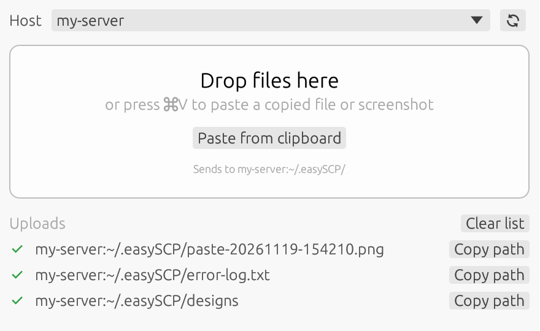

# EasySCP

Drop a file on the window, or paste one, and it's copied to a server from your SSH config.

<p align="center">
  
</p>

It's handy for getting screenshots and other files onto a remote machine without typing an `scp` command each time.

## Setup

EasySCP runs on macOS. You need:

- **Rust** 1.84 or newer. Install it from [rustup.rs](https://rustup.rs).
- **Apple's command line tools**, if you don't already have them: `xcode-select --install`
- **A server you can `ssh` into without typing a password**, listed in `~/.ssh/config`. See [Your SSH config](#your-ssh-config).

Clone this repository, then build the app:

```sh
cd EasySCP
./bundle.sh
```

That creates `dist/EasySCP.app`. Open it from there, or drag it into Applications to keep it.

> Build it on the Mac you'll use it on. A copy sent over from another Mac may be blocked by macOS, because the app isn't signed by a registered developer.

## Using it

1. **Pick a host** from the dropdown. EasySCP remembers it for next time.
2. **Send something**, in any of these ways:
   - Drag files or folders anywhere onto the window.
   - Copy a file in Finder, or copy a screenshot, then press <kbd>⌘</kbd><kbd>V</kbd> in the window.
   - Click **Paste from clipboard**.
3. **Watch the list.** Each item shows a spinner while it uploads and a ✔ when it's done. If something goes wrong, the error appears under it.

Everything lands in `~/.easySCP/` on the server. The folder is created the first time you send something.

Click **Copy path** next to a finished upload to copy where it is on the server, for example `~/.easySCP/paste-20261119-154210.png`.

When the list gets long, click **Clear list**. It only tidies the window: the files stay on the server, and anything still uploading stays in the list.

> Tip: <kbd>⌃</kbd><kbd>⇧</kbd><kbd>⌘</kbd><kbd>4</kbd> copies a screenshot of a selected area straight to the clipboard.

### File names

- Files and folders keep their own names.
- A pasted image has no name, so it's called `paste-` plus the date and time, like `paste-20261119-154210.png`.
- If a file with the same name is already on the server, it's replaced.

## Your SSH config

The dropdown lists the `Host` names in `~/.ssh/config`, along with those in any files it brings in with `Include`. Pattern entries such as `Host *.example.com` are left out, since they don't name a single machine.

A minimal entry looks like this:

```
Host my-server
    HostName my-server.example.com
    User me
```

Before using a host with EasySCP, check that this logs you in from Terminal without asking for anything:

```sh
ssh my-server
```

EasySCP can't show password or passphrase prompts, so the login has to work with a key. If `ssh` asks for your key's passphrase, add the key to your agent with `ssh-add` first.

If you add a host while the app is open, click the reload button next to the dropdown.

## Troubleshooting

| What you see | What to do |
| --- | --- |
| The dropdown is empty | Add a `Host` entry to `~/.ssh/config`, then click reload. |
| "Choose a host first." | Pick a host, then drop or paste again. |
| "The clipboard doesn't hold a file or an image." | Copy a file in Finder or an image, not text, then paste. |
| A "Permission denied" error under an upload | Make sure `ssh <host>` logs in without a prompt. |
| A timeout error under an upload | The server didn't answer within 15 seconds. Check your network or VPN. |

## Changing things

- **Destination folder:** edit `REMOTE_DIR` in `src/transfer.rs`, then run `./bundle.sh` again.
- **Run without building the app:** `cargo run --release`
- **Run the tests:** `cargo test`
